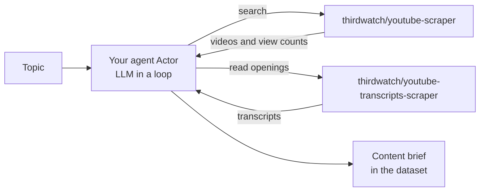

# Build a high-value Actor with AI

The build-along for **AI Tools that Earn**, the Apify hackathon in Bengaluru (November 22, 2026).

In 40 minutes we build an AI agent, ship it to the Apify platform as an Actor, and put a price
on it. The agent does not scrape anything itself. It uses Actors that already exist in
[Apify Store](https://apify.com/store) as its tools, and turns their raw data into something a
person would pay for.

We follow this page from top to bottom on screen. Keep it open: it is also your guide for the
rest of the day.

Adapted from Apify's [build-ai-agents-pycon-greece](https://github.com/apify/build-ai-agents-pycon-greece)
workshop. Same lifecycle, new example.

## The session

| Starts at | What we do | Time |
| --- | --- | --- |
| 0:00 | [What we build](#what-we-build), and why someone pays for it | 3 min |
| 0:03 | [Step 1: Deploy your first Actor](#step-1-deploy-your-first-actor) | 6 min |
| 0:09 | [Step 2: Build the agent](#step-2-build-the-agent) | 16 min |
| 0:25 | [Step 3: Call it from anywhere](#step-3-call-it-from-anywhere) | 3 min |
| 0:28 | [Step 4: Monetize and publish](#step-4-monetize-and-publish) | 5 min |
| 0:33 | [Step 5: Make it better, then make it yours](#step-5-make-it-better-then-make-it-yours) | 4 min |
| 0:37 | Questions | 3 min |

- **Not set up yet?** Do [Before the session](#before-the-session) first. It takes ten minutes.
- **Falling behind?** Skip to [Stuck? Use the finished agent](#stuck-use-the-finished-agent). You
  lose nothing, and you can read the code afterwards.
- **Your run is slow, or the Wi-Fi drops?** [Real runs](#real-runs) has finished briefs from the
  same agent.

## What we build

A **YouTube content brief agent**.

- **Who pays:** a YouTube creator or a content agency. Before scripting a video, they spend
  hours working out what already performs in their niche.
- **Input:** one topic, for example `how to start investing`.
- **Output:** a brief with the most-viewed videos, the exact words each one opens with, the
  patterns behind those hooks, and three script ideas.



The loop in the middle is a **ReAct agent**: the model reasons about what it needs, acts by
calling a tool, observes the result, and repeats until it can answer. You will watch it do
exactly that in the run log.

The finished agent is in [`solution/`](./solution). You build your own copy in
[`python-langgraph/`](./python-langgraph).

### What it returns

A real run for the topic `how to start investing`: 76 seconds, three tool calls, about 6 cents.
This is an excerpt. The full brief and two more are in [`examples/`](./examples).

**The gap it found**

> Few open with a concrete, checkable starting action a viewer can take this week, such as the
> first account to open, the first dollar amount, or the specific mistake that costs beginners
> the most in year one.

**How the most-viewed videos open, word for word**

| Channel | Views | First words of the video |
| --- | --- | --- |
| Pranjal Kamra | 22,137,943 | "When 10 year old kids picked shares against them were Chartered Account, they also picked shares. There the 10-year-old kids picked better stocks and made more money." |
| Pushkar Raj Thakur | 16,514,957 | "Well, a few days ago, I get a phone call from a relative of mine and on the phone he asks me that Pushkar, how do you invest in the stock market? I also have to invest some money." |
| TED-Ed | 13,635,484 | "In the 1600s the Dutch East India Company employed hundreds of ships to trade gold, porcelain, spices, and silks around the globe." |

**One of its three script ideas**

> **I Invested \$100 For 30 Days. Here's the Exact Account, Fees, and First Trade I Made**
>
> Most beginner investing videos tell you what to do. I'm going to show you what I actually did
> with a hundred dollars and the three mistakes I almost made in the first week.

### Why someone pays for it

Every project at this hackathon is judged on one question: **would someone actually pay for
this?** Rows of data rarely pass that test. A conclusion does.

| Raw data | A conclusion someone pays for |
| --- | --- |
| 10,000 company names | The 40 that raised funding this month, with contacts |
| 500 YouTube search results | What is winning in your niche, and three videos to make next |
| 300 flat listings from three sites | The five flats worth visiting this weekend, and why |

Store Actors fetch the data. Your agent reasons over it and writes the conclusion. You sell the
conclusion.

## Before the session

Ten minutes of setup at home saves you the first ten minutes of hacking time.

1. Create a free [Apify account](https://console.apify.com/sign-up). The free plan's monthly
   credits cover this workshop many times over.
2. Check you have [Python 3.10+](https://www.python.org/downloads/): `python --version`.
3. Install the [Apify CLI](https://docs.apify.com/cli/docs/installation) and log in:

   ```bash
   curl -fsSL https://apify.com/install-cli.sh | bash
   apify login --method console
   apify info
   ```

   On Windows (PowerShell), install with `irm https://apify.com/install-cli.ps1 | iex`.

4. Have an AI coding tool with Agent Skills support ready:
   [Cursor](https://cursor.com/) (the free tier works) or
   [Claude Code](https://docs.claude.com/en/docs/claude-code) (needs a paid plan).
5. Fork this repo and clone your fork.
6. Install the Apify Actor Development skill into your AI coding tool. For Claude Code, from the
   root of your clone:

   ```bash
   git clone --depth 1 https://github.com/apify/agent-skills.git /tmp/agent-skills
   mkdir -p .claude/skills
   cp -r /tmp/agent-skills/skills/apify-actor-development .claude/skills/
   ```

   For other tools, copy the same folder into the skills folder your tool's docs point to.

7. Prove it all works by deploying the untouched template:

   ```bash
   cd python-langgraph
   apify push
   ```

   If the CLI prints a link to your Actor in Apify Console, you are ready.

You need no OpenAI or Anthropic key. The agent calls its LLM through the
[Apify OpenRouter proxy](https://apify.com/apify/openrouter), paid from your Apify credits.

> **Note:** your account must be able to run public Actors, because both the tool Actors and
> the OpenRouter proxy are public Actors. The free plan can. The $1 Creator plan cannot, so do
> not use a Creator-plan account for this workshop.

---

## Step 1: Deploy your first Actor

An **[Actor](https://docs.apify.com/platform/actors)** is a serverless program on the Apify
platform. JSON input goes in, the Actor runs a task, and results go out to a
[dataset](https://docs.apify.com/platform/storage/dataset). Everything today builds on that
shape.

**Time:** ~6 minutes

### 1. Tour the structure

Your Actor is the [`python-langgraph/`](./python-langgraph) folder: Apify's Python LangGraph
agent template, already wired to the Apify OpenRouter proxy.

```bash
cd python-langgraph
```

- [`.actor/actor.json`](https://docs.apify.com/platform/actors/development/actor-definition/actor-json) -
  the Actor's name, description, and configuration.
- [`.actor/input_schema.json`](https://docs.apify.com/platform/actors/development/actor-definition/input-schema) -
  the JSON input the Actor accepts. Apify Console turns it into a form.
- `my_actor/main.py` - runs the agent loop.
- `my_actor/tools.py` - the tools the agent can call.
- `my_actor/models.py` - the shape of the data the tools and the agent return.
- [`Dockerfile`](https://docs.apify.com/platform/actors/development/actor-definition/dockerfile) -
  how the Actor is built and run.

### 2. Deploy and run it

The OpenRouter proxy works only for Actors running on the Apify platform, so every run today
happens there, not on your laptop.

```bash
apify push
```

The CLI builds the Actor on the platform and prints a link to it in Apify Console. Open it,
keep the prefilled input, and click **Start**. Watch the **Log** tab, then open the **Dataset**
tab.

**Your project:** look at `.actor/input_schema.json` and decide the one input your own agent
would take. Write it the way your buyer would say it.

---

## Step 2: Build the agent

Turn the template into the YouTube content brief agent.

**Time:** ~16 minutes

### 1. Understand the pattern

An AI agent on Apify is an Actor with three parts:

- **The agent loop runs inside the Actor.** An LLM reasons, picks a tool, reads the result, and
  repeats until it can answer.
- **Store Actors are the tools.** When the agent needs data, it runs another Actor with the
  [Apify client for Python](https://docs.apify.com/api/client/python/). Every run on the
  platform gets `APIFY_TOKEN` automatically, so the client needs no setup.
- **The dataset is the output.** Whatever the agent concludes is written to the dataset.

The LLM client points at the Apify OpenRouter proxy, an OpenAI-compatible endpoint. It takes
your `APIFY_TOKEN` as the API key and any [OpenRouter model slug](https://openrouter.ai/models)
as the model:

```python
llm = ChatOpenAI(
    model='anthropic/claude-haiku-5.5',
    base_url='https://openrouter.apify.actor/api/v1',
    api_key=os.environ['APIFY_TOKEN'],
)
```

The proxy only accepts the token of the run itself. The tokens are billed to whoever runs the
Actor, and a token from another account does not work.

### 2. Meet the tool Actors

Open each one in Apify Store and read its input and output. Picking good tools is half the job.

| Tool Actor | What the agent uses it for | Input it needs | Output fields the agent reads |
| --- | --- | --- | --- |
| [thirdwatch/youtube-scraper](https://apify.com/thirdwatch/youtube-scraper) | Find the most-viewed videos for a topic | `queries` (list of search terms), `maxResults`, `searchType: "videos"`, `sort: "viewCount"` | `title`, `url`, `channelName`, `viewCount`, `durationText`, `publishedTimeText`, `isShort` |
| [thirdwatch/youtube-transcripts-scraper](https://apify.com/thirdwatch/youtube-transcripts-scraper) | Read how each video opens | `videoUrls` (list), `maxResults`, `includeTimestamps: false`, `includeMetadata: true` | `video_url`, `title`, `channel_name`, `view_count`, `transcript_text` |

Both are pay per result. One run of this agent costs about 6 cents in total.

### 3. Vibe-code it

Open the repo in your AI coding tool and give it this prompt:

```
Turn the Actor in python-langgraph/ into a YouTube content brief agent.

Input: a "topic" string (required) and "maxVideos" (integer, default 5). Keep "modelName"
and "debug", and change the default model to "anthropic/claude-haiku-5.5".

Tools (replace the existing ones in my_actor/tools.py). Each tool runs a Store Actor with
Actor.apify_client and reads its dataset:
1. search_youtube_videos(query, max_results, sort_by) runs thirdwatch/youtube-scraper and
   returns title, url, channel, views, duration, and published for each video. Leave out Shorts.
2. get_video_openings(video_urls) runs thirdwatch/youtube-transcripts-scraper and returns, for
   each video, only the first 1,200 characters of transcript_text as "opening", plus url, title,
   channel, and views. Also return the URLs that had no transcript.
Use the input and output fields listed in the "Meet the tool Actors" table in README.md.
If a tool Actor fails, return the error as text so the agent can react.

Agent: keep create_agent from LangChain. Add a system prompt that tells it to search for the
most-viewed videos on the topic, read the openings of the top maxVideos, and write a brief
using only what the tools returned, quoting hooks word for word. Cap the loop with a
recursion limit, cap the model's answer with max_tokens and a timeout, and if the agent
raises, fail the run with a clear status message instead of pushing a result.

Output: a structured ContentBrief with topic, summary, winning_videos (title, url, channel,
views, hook, why_it_works), hook_patterns, and three script_ideas (title, hook, outline).
Push the brief to the dataset as one item and save a Markdown version to the key-value store
as brief.md. Log each tool call and tool result at INFO level so the loop is visible in the
Log tab.

Keep using the Apify OpenRouter proxy (https://openrouter.apify.actor/api/v1) as the LLM,
authenticated with APIFY_TOKEN, so no provider API key is needed. Update the input schema,
dataset schema, and actor.json to match. Follow the Apify Actor Development skill.
```

Review what it writes. Three things to check before you push:

- `tools.py` returns a short, clean result. A full transcript can be 100,000 characters. The
  agent only needs the opening, so that is all the tool should hand back. Smaller tool results
  mean a cheaper, faster, and more accurate agent.
- `models.py` describes the brief you want. The output shape is your product.
- `.actor/input_schema.json` asks for a topic in plain words.

### 4. Push and run it

```bash
apify push
```

Start the Actor in Apify Console with a topic. In the **Log** tab you see the loop:

```
AGENT -> search_youtube_videos({"query": "how to start investing", "max_results": 10, "sort_by": "viewCount"})
TOOL  <- search_youtube_videos returned 10 videos
AGENT -> get_video_openings({"video_urls": ["https://www.youtube.com/watch?v=...", "..."]})
TOOL  <- get_video_openings returned 5 openings (0 videos had no transcript)
Pushed the brief into the dataset!
```

Then open the **Dataset** tab for the structured brief, and the **Key-value store** tab for
`brief.md`.

A run takes one to two minutes. Pick a topic where people talk on camera. Music-only videos
have no transcript to read.

Nothing on your screen yet? Open [Real runs](#real-runs) and read a finished brief while yours
completes.

> **Note:** pick the model on evidence, not habit. In test runs of this agent, the template's
> default `openai/gpt-4o-mini` made an extra tool call it did not need in all three runs and
> failed on the structured brief in two of them. `anthropic/claude-haiku-5.5` finished every
> one of its test runs and costs less per token. Change `modelName` in the input to try any
> other OpenRouter model, and run it more than once before you trust it.

**Your project:** swap the three parts for your idea - the input, the tool Actors, and the
output. The pattern stays the same.

### Stuck? Use the finished agent

The working agent is in [`solution/`](./solution). Deploy it as is:

```bash
cd solution
apify push
```

Then read `solution/my_actor/tools.py` and `solution/my_actor/main.py`. Together they are under
250 lines.

### Use your own LLM key instead

<details>
<summary>Call OpenAI directly with your own <code>OPENAI_API_KEY</code>, and run locally</summary>

With your own key, the agent no longer needs the proxy, so it also runs on your machine with
`apify run`.

1. Add the key to your shell environment. Never commit keys to the repo.

   ```bash
   export OPENAI_API_KEY="sk-..."
   ```

2. In `my_actor/main.py`, use the provider's client with its defaults and an OpenAI model name:

   ```python
   llm = ChatOpenAI(model='gpt-4o-mini')
   ```

3. Run it locally. `apify run` injects your token from `apify login` as `APIFY_TOKEN`, so the
   tool Actors still work. Output lands in `storage/datasets/default/`.

4. Give the deployed Actor its own copy of the key as a secret, then `apify push`:

   ```bash
   apify secrets add openaiApiKey "sk-..."
   ```

   ```json
   "environmentVariables": {
       "OPENAI_API_KEY": "@openaiApiKey"
   }
   ```

5. When you monetize in step 4, your event prices need to cover your token costs.

</details>

---

## Step 3: Call it from anywhere

Your agent runs in the cloud, so anyone, or any other agent, can start it.

**Time:** ~3 minutes

### 1. Over the API

Every Actor has a run endpoint. This call starts your agent, waits, and returns the brief:

```bash
curl -X POST "https://api.apify.com/v2/acts/<your-username>~<actor-name>/run-sync-get-dataset-items" \
  -H "Authorization: Bearer <YOUR_API_TOKEN>" \
  -H "Content-Type: application/json" \
  -d '{"topic": "how to start investing"}'
```

Your API token is in Apify Console under **Settings > API & Integrations**. Treat it like a
password. See the [Apify API reference](https://docs.apify.com/api/v2).

### 2. Over MCP

Your Actor is also reachable through the [Apify MCP server](https://docs.apify.com/platform/integrations/mcp).
Point any MCP client - Claude, Cursor, or another agent - at `https://mcp.apify.com` and it can
discover and run your Actor as a tool. Combined with pay per event in step 4, this is how an
autonomous agent finds and pays for your Actor.

**Your project:** who calls your agent - a person in Apify Console, your own app over the API,
or another agent over MCP?

---

## Step 4: Monetize and publish

Put a price on the brief, then publish the Actor to Apify Store.

**Time:** ~5 minutes

### 1. Price it with pay per event

With **pay per event (PPE)**, users pay for events you define. Two
[synthetic events](https://docs.apify.com/platform/actors/publishing/monetize/pay-per-event#synthetic-events)
are charged automatically, with no code in your Actor:

- `apify-actor-start` - charged on every run start. Keep the default price.
- `apify-default-dataset-item` - charged for each item written to the default dataset. Our
  agent pushes one item per brief, so this is the price of a brief.

How to think about the price:

- **Start from the buyer, not from your cost.** A brief replaces hours of research for a
  creator. That is what you are pricing.
- **Know your floor.** One run uses about 10 search results and 5 transcripts from the tool
  Actors, plus LLM tokens. That came to about 6 cents in test runs. Check the cost of your own
  test runs in Apify Console before you set a price.
- **You keep 80% of what users pay,** minus the platform costs of the runs.

> **Note:** the tool Actors and the OpenRouter proxy both run on the token of the user who
> starts your Actor, so the user pays for them directly, on top of your event price. Keep the
> total in mind when you set that price.

### 2. Set it up

Add your billing details under **Settings > Billing** and complete
[identity verification](https://docs.apify.com/platform/actors/publishing/monetize/monthly-payouts#verify-your-identity).
Then, in the **Publishing** tab of your Actor, open **Monetization** and follow the wizard: set
the event prices, pick the primary event, review, and submit. Leave **Pay per event + usage**
off.

### 3. Publish

In the **Publishing** tab, complete the checklist and submit your Actor to Apify Store. Your
listing is your landing page. Name the buyer in the first line, show a real output, and say
what one result costs.

**Your project:** what one event is the value your agent delivers, and what would your buyer
pay for it?

---

## Step 5: Make it better, then make it yours

You have the full lifecycle. Now make the agent worth more, then point the same pattern at your
own idea.

**Time:** ~4 minutes in the session, then the rest of the day

### 1. Give the agent more to look at

YouTube shows what won over years. Short video shows what is working this week, and a short
video has only a few seconds to hook a viewer. Add one more tool and the same agent covers both.

| Add | Tool Actor | Input it needs | Output fields the agent reads |
| --- | --- | --- | --- |
| What is trending on TikTok | [thirdwatch/tiktok-scraper](https://apify.com/thirdwatch/tiktok-scraper) | `queries` (search terms, `@usernames`, or `#hashtags`), `searchType: "videos"`, `maxResults` | `description` (the caption), `hashtags`, `viewCount`, `likeCount`, `shareCount`, `createdAt`, `url` |
| Which Reels work for creators who already win | [thirdwatch/instagram-reels-scraper](https://apify.com/thirdwatch/instagram-reels-scraper) | `queries` (`@usernames` or profile URLs), `maxResults` | `caption`, `hashtags`, `viewCount`, `likeCount`, `commentCount`, `timestamp`, `url` |

Both return captions and counts, not the words spoken in the video. So the agent compares the
caption hooks from short video with the spoken hooks from YouTube.

A new tool is three small changes. Here they are for TikTok:

1. One function in `my_actor/tools.py`. Same three moves as the other tools: build the input,
   run the Store Actor, hand back less.

   ```python
   TIKTOK_ACTOR = 'thirdwatch/tiktok-scraper'


   @tool
   async def search_tiktok_videos(query: str, max_results: int = 10) -> list[dict] | str:
       """Search TikTok and return short videos on a topic with their captions and engagement.

       Args:
           query: What to search for, written the way a viewer would type it.
           max_results: How many videos to return (1 to 20).

       Returns:
           A list of videos, each with caption, url, creator, views, shares, hashtags, and posted.
       """
       run_input = {
           'queries': [query],
           'searchType': 'videos',
           'maxResults': max(1, min(max_results, 20)),
       }
       try:
           items = await run_store_actor(TIKTOK_ACTOR, run_input)
       except Exception as exc:  # noqa: BLE001 - report the failure to the agent so it can react
           return f'The TikTok search failed: {exc}. Write the brief without it.'

       # Tools return less: a short caption and a few numbers, not the whole record.
       return [
           {
               'caption': (item.get('description') or '')[:300],
               'url': item.get('url'),
               'creator': item.get('authorName'),
               'views': item.get('viewCount'),
               'shares': item.get('shareCount'),
               'hashtags': (item.get('hashtags') or [])[:8],
               'posted': (item.get('createdAt') or '')[:10],
           }
           for item in items
       ]
   ```

2. In `my_actor/main.py`, import it, add it to the tool list, and add one step to the system
   prompt so the agent knows when to call it:

   ```python
   tools = [search_youtube_videos, get_video_openings, search_tiktok_videos]
   ```

   ```
   Before you write the brief, call search_tiktok_videos once with the topic to see what is
   working in short video right now.
   ```

3. One field in `ContentBrief` in `my_actor/models.py`, so the new finding has a place in the
   output:

   ```python
   short_video_trends: list[str] = Field(
       description='Two or three things the most-viewed TikTok videos do in their captions, each naming the creator.',
   )
   ```

Then `apify push` and run it. The log shows a third tool call, and the dataset item has the new
field.

Every tool call is paid for by whoever runs your agent, so open the **Pricing** tab of an Actor
in Apify Store before you add it as a tool. In a test run, the TikTok tool added about 4 cents
for 9 videos, which took one brief from about 6 cents to about 10.

### 2. Make it something people run every week

A creator needs this brief every week, not once. Run the Actor on a
[schedule](https://docs.apify.com/platform/schedules), keep last week's brief in a named
[key-value store](https://docs.apify.com/platform/storage/key-value-store), and report what
changed. Repeat use is what turns a demo into revenue.

### 3. Make it yours

For the hackathon, change three things and keep everything else.

| Swap | In the workshop | In your project |
| --- | --- | --- |
| The input | A topic | What your buyer would type |
| The tools | Two YouTube Actors | Any Actors from [Apify Store](https://apify.com/store) |
| The output | A content brief | The conclusion your buyer pays for |

#### Start from the buyer

Before you write a prompt, finish this sentence: "**[A specific person]** pays for this because
it saves them **[a specific job]**." If you cannot, change the idea, not the code.

#### Idea starters

Each one is the same agent with different tools. All of these tool Actors are live in Apify
Store.

| Buyer | They type | Tool Actors | They get |
| --- | --- | --- | --- |
| Someone house hunting in Bengaluru | "2 BHK in Koramangala under 50k" | [nobroker-scraper](https://apify.com/thirdwatch/nobroker-scraper), [magicbricks-scraper](https://apify.com/thirdwatch/magicbricks-scraper), [acres99-scraper](https://apify.com/thirdwatch/acres99-scraper) | The five flats worth visiting, with reasons |
| A recruiter | A company name | [linkedin-company-employees-scraper](https://apify.com/thirdwatch/linkedin-company-employees-scraper), [naukri-jobs-scraper](https://apify.com/thirdwatch/naukri-jobs-scraper) | Who they are hiring, and who just joined |
| A D2C founder | A product category | [amazon-product-scraper](https://apify.com/thirdwatch/amazon-product-scraper), [amazon-reviews-scraper](https://apify.com/thirdwatch/amazon-reviews-scraper) | The top complaints about competitors, and the gap to build for |
| A B2B sales rep | An industry and a city | [justdial-business-scraper](https://apify.com/thirdwatch/justdial-business-scraper), [indiamart-supplier-scraper](https://apify.com/thirdwatch/indiamart-supplier-scraper) | A ranked lead list with a reason to call each one |
| A product manager | A product or brand name | [reddit-scraper](https://apify.com/thirdwatch/reddit-scraper) | What users love, hate, and keep asking for |

#### Five rules that separate a demo from a product

1. **One input, in the buyer's words.** If the form needs a manual, the idea is too wide.
2. **Tools return less.** Trim every tool result to what the model needs.
3. **The output is a decision, not a table.** Rank, score, shortlist, or summarize.
4. **Never invent.** Tell the model to use only what the tools returned, and to quote sources.
5. **Cap the loop.** Set a recursion limit so a confused agent cannot spend without end.

---

## Real runs

What the finished agent in [`solution/`](./solution) returned for three topics. Nothing was
edited: each brief is the `brief.md` from the run's key-value store, and each JSON file is the
run's one dataset item.

| Input topic | Run time | The brief | The dataset item |
| --- | --- | --- | --- |
| `how to build AI agents` | 65 s | [Read the brief](./examples/how-to-build-ai-agents.md) | [JSON](./examples/how-to-build-ai-agents.json) |
| `how to start investing` | 76 s | [Read the brief](./examples/how-to-start-investing.md) | [JSON](./examples/how-to-start-investing.json) |
| `how to learn coding` | 105 s | [Read the brief](./examples/how-to-learn-coding.md) | [JSON](./examples/how-to-learn-coding.json) |

All three ran on `anthropic/claude-haiku-5.5` through the Apify OpenRouter proxy. Each made
three tool calls: one search, one read of the openings, and the structured brief.

---

## Resources

- [Apify platform](https://docs.apify.com/platform), [Actors](https://docs.apify.com/platform/actors),
  and [Apify Store](https://apify.com/store)
- [Apify CLI](https://docs.apify.com/cli/), [Apify SDK for Python](https://docs.apify.com/sdk/python),
  and [Apify client for Python](https://docs.apify.com/api/client/python/)
- [Apify OpenRouter proxy](https://apify.com/apify/openrouter) and
  [OpenRouter models](https://openrouter.ai/models)
- [Apify MCP server](https://docs.apify.com/platform/integrations/mcp) (`https://mcp.apify.com`)
- [Pay per event](https://docs.apify.com/platform/actors/publishing/monetize/pay-per-event) and
  [Publish your Actor](https://docs.apify.com/platform/actors/publishing/publish)
- [apify/agent-skills](https://github.com/apify/agent-skills) and
  [LangChain agents](https://docs.langchain.com/oss/python/langchain/agents)
- The original workshop: [apify/build-ai-agents-pycon-greece](https://github.com/apify/build-ai-agents-pycon-greece)
