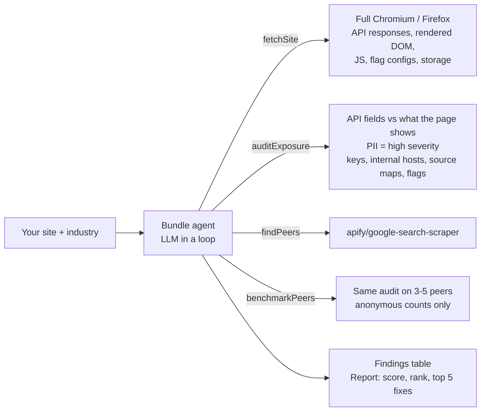

# Bundle

**A business exposure audit for your web app, benchmarked against your industry.**

Built at **AI Tools that Earn**, the Apify hackathon in Bengaluru (November 22, 2026), on the
agent pattern from [thirdwatch-dev/build-ai-agents-apify-bengaluru](https://github.com/thirdwatch-dev/build-ai-agents-apify-bengaluru).

- **Actor:** [`cherubic_treecreeper/bundle`](https://apify.com/cherubic_treecreeper/bundle) on Apify Store
- **Price:** $1.99 per completed audit (pay per event)

## The problem

Every web app sends data to the browser that the page never shows: extra API fields, internal
hostnames, source maps, flags for unreleased features. Nothing looks wrong on screen, so nobody
notices, until someone opens DevTools. In India, the DPDP Act, 2023 makes sending personal
data a page doesn't need a business risk, with penalties up to INR 250 crore for failing to
safeguard data.

## Who pays, and why

| Buyer | What they get |
| --- | --- |
| Founder or CISO of a consumer app | A score, a rank against competitors, and the 5 fixes to make first |
| Product or platform team | The exact field paths, endpoints, and files to fix |
| Compliance lead preparing for DPDP | A recurring, evidence-backed check of what the public site exposes |

## How it works



- **The agent decides.** A LangChain `create_agent` loop picks its own tools: whether to search
  for peers, which ones to benchmark, and when it has enough to write the report. Every call is
  logged as `[agent] calling fetchSite on example.in`.
- **The core check:** every first-party JSON response is flattened to field paths and compared
  with the text and attributes the page renders. Fields the UI never shows are flagged;
  personal data (PAN, Aadhaar, phone, email, date of birth, account numbers, internal IDs, risk
  scores) is high severity.
- **Numbers from code, words from the AI.** The score, rank, and industry average are computed in
  code. The AI writes the fixes, and can only cite findings the code actually made.
- **Privacy by design.** Field values never leave the check: they are not stored, logged, or sent
  to the model. Peers are anonymous counts.
- **Honest loading.** Sites are opened with a normal full browser, directly first, then via Apify
  Proxy (residential), then Firefox. Bot checks and CAPTCHAs are never bypassed.
- **The AI model** runs through the [Apify OpenRouter proxy](https://apify.com/apify/openrouter),
  so no provider key is needed. The loop is capped by a recursion limit, `max_tokens`, and a timeout.

## Pricing

**$1.99 per completed audit** (`question-answered` pay-per-event event). A run that cannot load
the site is not charged.

| Cost per audit (measured on real runs) | |
| --- | ---: |
| Bundle's compute (paid by the developer under pay per event) | $0.03 - $0.05 |
| Residential proxy, only when a site refuses a direct connection | up to $0.25 |
| AI model and one Google search (paid by the user, through their Apify account) | under $0.01 |
| **Developer margin** (80% of $1.99, minus compute and any proxy) | **about $1.29 - $1.56** |

Why $1.99: a manual review of what a site's APIs and bundles expose takes an engineer hours.
Bundle does it, with an industry benchmark, in minutes, and is cheap enough to run every month.

## Repository

| Path | What it is |
| --- | --- |
| [`bundle/`](./bundle) | The Actor: `.actor/` schemas, Dockerfile, Store README, and the agent in `my_actor/` |
| [`bundle/my_actor/main.py`](./bundle/my_actor/main.py) | The agent loop, prompt, and report assembly |
| [`bundle/my_actor/tools.py`](./bundle/my_actor/tools.py) | The four tools the agent chooses from |
| [`bundle/my_actor/exposure.py`](./bundle/my_actor/exposure.py) | API fields vs rendered DOM, PII detection (pure, tested) |
| [`bundle/my_actor/audit.py`](./bundle/my_actor/audit.py) | Findings, severity, score, grouping, peer benchmark |
| [`bundle/my_actor/extractor.py`](./bundle/my_actor/extractor.py) | Keys, endpoints, and flags in JavaScript (pure, with a CLI) |
| [`bundle/my_actor/collector.py`](./bundle/my_actor/collector.py) | The browser capture behind `fetchSite` |
| [`bundle/tests/`](./bundle/tests) | pytest tests (21) |

## Run it

You need Python 3.12+, the [Apify CLI](https://docs.apify.com/cli/docs/installation), and an
Apify account.

```bash
cd bundle
python -m pytest -q tests    # tests, no network
apify login
apify push                   # the OpenRouter proxy only works on the Apify platform
```

Then open the Actor in Apify Console, enter a website and an industry, and click **Start**.

## Demo

1. Start an audit with a website, an industry, and no peers. In the **Log**, watch the agent call
   `fetchSite`, `auditExposure`, `findPeers` (Google), and `benchmarkPeers`.
2. Open **Output**: the **Findings** table, then **Report (web page)** with the score, the rank,
   the benchmark chart, and the top 5 fixes.
3. Run it again with **Use saved captures** on: the same audit in about a minute, for $0.03.

## Ethics and limits

Audit sites you own or are allowed to assess. Public pages only: no login, no probing, and no
bypassing of bot checks. Field values are never stored, and peers are shown only as anonymous
counts. Logged-in areas are out of scope, so a clean result is not a clean bill of health.
DPDP notes are context, not legal advice.
